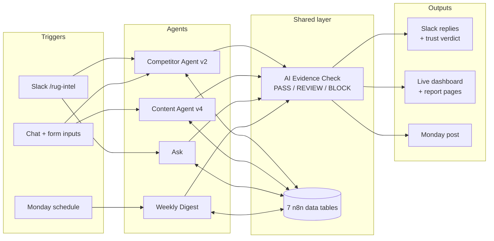

# Wayfair Rugs Market Intelligence: AI Agent System

An n8n multi-agent system built during the **Wayfair AI Agent Engineering Externship** (Extern, Aug–Oct 2026) for Wayfair's Rugs category. It discovers rug trends, benchmarks Wayfair against Amazon and Walmart, turns both into an on-brand content plan, and pulls everything into one dashboard.

On top of the five externship phases I built **Rug Intel**, an extension that makes the agents usable day to day:
- a Slack app
- an evidence check on every AI output
- a weekly change digest
- a live dashboard

## The problem

**The business problem.** Rug styles rise and fade quickly, and Amazon and Walmart change prices and assortment every week. Wayfair's Rugs team needs to spot those shifts **before trends reach the homepage**, early enough to adjust pricing, plan assortment and stock, and brief marketing. Today that means an analyst manually browsing competitor sites and social media, copying listings into spreadsheets and writing a report. That's slow, it only covers what one person has time to check, and it's out of date by the time it's shared.

**The problem with just adding AI.** The externship's goal was to automate this research with AI agents, and they do produce a full report in minutes. But a fast report creates new problems at work:
- **AI can invent numbers.** A report can look finished and confident while containing a price or a percentage that doesn't exist in the data, and nothing flags it.
- **Failures are silent.** A run can report "success" with a whole section missing.
- **The output is hard to use.** Reports live as files inside a workflow tool most of the team never opens, and they go stale until someone reruns them by hand.

**The goal.** Give the team early, evidence-based market signals they can **trust** and **act on**, delivered where they already work, and kept current without anyone remembering to rerun anything. The five externship agents solve the speed problem. Rug Intel solves the trust and usability problems.

## What it does

### The externship build (Phases 1–5)

| Phase | Agent | Input → Output |
|---|---|---|
| 1 | **Moodboard Generator** | Trend micro-segment → AI-generated room moodboards (FLUX.1-schnell) |
| 2 | **Trend Discovery** | Rug category → trend report with 2–3 style micro-segments and the evidence behind each (Amazon listings, Instagram, Pinterest, design blogs) |
| 3 | **Competitor Monitoring** | Rug category → Wayfair vs. Amazon vs. Walmart benchmark on price, assortment, ratings and discounts |
| 4 | **AI Insights & Content** | Trend + competitor reports, audience, season → content plan (blog ideas, captions, campaigns, emails, competitive angles) in Wayfair's voice |
| 5 | **Market Intelligence Dashboard** | Both reports → one HTML dashboard (code parser, no AI, so every figure is copied exactly) |

### Rug Intel (beyond the externship)

| Part | What it does |
|---|---|
| **AI Evidence Check** | A shared sub-workflow every report goes through. It traces each number back to the collected listings, flags non-answers, banned phrases and copied example lines, adds an AI second opinion on claims, and returns **PASS**, **REVIEW** or **BLOCK**. Only rule-based checks can block; the AI only advises. |
| **Slack integration** | `/rug-intel deep-dive <category> focus: <x>`, `/rug-intel ask <question>` and `/rug-intel status`. Verifies Slack's request signature, replies within Slack's 3-second limit, then posts the checked answer to the channel. |
| **Ask agent** | Answers questions from the stored listings and cites listing IDs. The answer goes through the Evidence Check. |
| **Weekly digest** | Compares this week's listings with last week's snapshot: price moves, new and removed products, rating changes. |
| **Live dashboard** | Reads the shared tables directly: where Wayfair sits per category, what changed this week, run health and every evidence verdict. |
| **Category config** | Each category is one row (search terms, competitors, owner team, price-move threshold, notes). Adding Outdoor Rug took one row. |
| **Error handler** | Attached to all production workflows; alerts on any crash so nothing fails silently. |

## Architecture



**Data tables:**
- `competitor_listings`
- `listing_snapshots`
- `agent_runs` (run log)
- `evidence_checks`
- `reports`
- `category_config`
- `weekly_digests`

## Highlights

- **Caught a wrong number before anyone saw it.** In one run the AI reported Wayfair's average price as $187.50. The Evidence Check traced it to the source data, where it was actually $202.58.
- **Blocked a non-answer.** A report section that only said "User Safety: safe" was blocked instead of being shipped.
- **Content checks.** In a content-plan run, 26 of 27 numbers traced back to the data. The check flagged a misused "80%" claim, a banned phrase used twice and four lines copied from the prompt examples.
- **Fixed bugs in the provided starter code.**
  - Three social fetch nodes returned nothing because of an extra `=`.
  - Several report agents had no model connected.
  - A whole section was dropped because the code referenced the wrong node name.
  - The dashboard parser was losing the attribute tables and discount tiers.

## Why it matters in a real work environment

The same job done three ways: an analyst researching by hand, the workflow built in the externship, and the same workflow with Rug Intel on top.

| Task | Analyst doing research by hand | Externship workflow | With Rug Intel |
|---|---|---|---|
| **Gathering data** | Browses Wayfair, Amazon and Walmart and copies listings into a spreadsheet | Pulls 10 listings per retailer automatically | Same, and every run is saved to shared tables, so history builds up |
| **Producing the report** | Hours of reading, comparing and writing | About 5–7 minutes per run | Same speed, started from Slack; results post back to the channel |
| **Who can start it** | The analyst | Someone with n8n access | Anyone in the Slack workspace (`/rug-intel deep-dive`) |
| **Trusting the numbers** | The analyst double-checks their own work | Looks finished, but nothing checks whether a number was invented | Every number traced to the data; each report scored **PASS**, **REVIEW** or **BLOCK** with the failing items named |
| **Bad or missing sections** | Noticed on review, if at all | A run can say "success" with a section empty | Run marked **degraded**, non-answers **blocked**, crashes trigger an alert |
| **Follow-up questions** | A new research request | Rerun the whole workflow | `/rug-intel ask` answers from stored listings in seconds, with listing IDs cited |
| **Staying current** | Redo the research | Someone remembers to rerun it | Monday digest posts price moves, new and removed listings, rating changes |
| **Sharing results** | Email a deck or spreadsheet | Download an HTML file and send it | Posted in the team channel, with a link to the live dashboard |
| **The dashboard** | Built by hand in slides or sheets | Rebuilt by uploading two reports | Live; updates after every run with run health and trust verdicts |
| **Content plan** | A marketer writes it from the report | AI drafts it from both reports | Same, with unsupported stats, banned phrases and copied lines flagged |
| **Adding a category** | Start the research from scratch | Copy and edit the workflow | Add one row to `category_config` (Outdoor Rug took one row) |

### ⏱ Time per task

| Task | Analyst by hand *(estimate)* | Externship workflow *(measured)* | With Rug Intel *(measured)* |
|---|---|---|---|
| Trend report (listings, social, blogs) | 4–6 hours | ~10 min | ~10 min *(same agent)* |
| Competitor benchmark (3 retailers, 30 listings) | 3–5 hours | 5–7 min, started in n8n | 5–7 min, **started from Slack** |
| Content plan | 3–4 hours | ~1.5 min, after uploading both reports | ~1.5 min, **numbers checked** |
| Follow-up question | 30–60 min | 5–7 min (rerun the workflow) | **seconds** (`/rug-intel ask`) |
| Weekly "what changed?" | 3–5 hours (redo the research) | 5–7 min per category, rerun by hand | **0 min hands-on** (Monday digest runs itself) |
| Updating the dashboard | 1–2 hours | a few minutes (upload two reports) | **0 min** (live, updates after every run) |
| Checking every number | part of the analyst's time | not done | **automatic** on every report |
| Adding a new category | days of new research | about an hour (copy and edit the workflow) | **minutes** (one config row) |
| **One weekly cycle** | **~1.5–2 working days** | **~20–30 min of runs, plus manual file handoffs** | **~20 min of agent time, a few minutes hands-on** |

> **⏱ About 1.5–2 days of manual research becomes roughly 20 minutes of agent time, and every number arrives already checked.**

*How these were measured:*
- The externship and Rug Intel times come from logged runs: competitor runs took 4.7–4.8 minutes, the content plan 1.4 minutes, Ask and the digest about 6 seconds each, and a trend report about 10 minutes.
- The analyst times are my estimates for doing the same scope by hand: reading and comparing about 30 listings plus social posts and blogs, then writing it up.
- The "about an hour" for adding a category to the externship workflow is also an estimate.

**Why this matters for a team:**
- **Answers come to the team.** People ask in Slack, where they already work, and the whole channel sees the same checked answer.
- **Nobody acts on an invented number.** The trust verdict shows what to double-check before an AI number reaches a pricing deck or a buying decision. In testing it caught an average price that was $15 off and a made-up "80%" claim.
- **Failures are visible.** A silent failure is worse than a crash, because people keep trusting partial output. Every run logs what it actually produced.
- **It scales without new engineering.** Another catalog team connects its own data feed, adds its categories as config rows and adjusts a few rug-specific prompt words. The rest carries over unchanged.

**What it doesn't do yet:** Rug Intel provides trend, demand and competitor-price signals. It doesn't see Wayfair's inventory, lead times, sales or landed costs; those would come from Wayfair's internal data in a production version.

## Repository layout

```
wayfair-externship/
├── docs/
│   ├── project-brief.md                  # project context and phase-by-phase notes
│   ├── beyond-the-brief-plan.md          # Rug Intel build plan and production mapping
│   ├── beyond-the-brief-demo-script.md   # live demo script
│   └── slack-setup.md                    # Slack app manifest and setup steps
├── workflows/
│   ├── exports-2026-10-16/               # final n8n workflow exports (secrets removed)
│   ├── beyond-the-brief/                 # Rug Intel workflow sources (n8n SDK) and code nodes (src/)
│   └── phase*.json                       # earlier snapshots of each phase
├── reports/                              # sample outputs: trend, competitor, content reports, dashboard
├── Wayfair_Final_Presentation_*.pptx     # presentation decks
└── loom-teleprompter.html                # teleprompter for the walkthrough video
```

## Running it yourself

1. **n8n:** self-host n8n (I used Docker on a small cloud VM) or use n8n Cloud.
2. **Import:** load the JSON files from `workflows/exports-2026-10-16/` into n8n.
3. **Credentials:** add your own in n8n. The exports contain placeholders only.
   - An OpenAI-compatible model. I used Mistral `ministral-14b-2512` on the free tier, plus OpenRouter free models for a few data agents.
   - A Hugging Face token for FLUX.1-schnell.
   - Slack, for the Rug Intel commands.
4. **Data tables:** create the seven tables listed above and add your categories to `category_config`.
5. **Slack:** follow `docs/slack-setup.md` and paste your app's signing secret into the **Sign Request** node. Don't commit it.
6. **Data source:** the externship's sample API only serves rug categories. For another category, point the fetch steps at a feed that returns the same fields (title, price, rating, reviews, retailer) and adjust the rug-specific prompt wording.

## Tech stack

- **Workflows:** n8n (self-hosted), with AI Agent nodes, Code nodes (JavaScript), Data Tables and webhooks.
- **Models:** Mistral `ministral-14b-2512`, OpenRouter free models, FLUX.1-schnell via Hugging Face. All on free tiers.
- **Integrations:** Slack (slash commands, signed requests, `response_url`).
- **Production mapping** (how this would run at Wayfair):

  | Prototype | Wayfair equivalent |
  |---|---|
  | Data tables | BigQuery |
  | Mistral / OpenRouter | Gemini on Vertex AI |
  | HTML dashboard | Looker |
  | Slack | Slack behind Google SSO |

## What I learned

1. **Trust is the real product.** An agent is only useful if it tells you which parts of its answer to double-check.
2. **Rules decide, AI advises.** When the AI checker started blocking sound sections, I limited blocking to rule-based checks.
3. **Quiet failures are the dangerous ones.** A run can finish "successfully" with a section missing, so every run now logs what it actually produced.

## What's next

- Match rising trends to the suppliers who make them, so sourcing can act before demand peaks.
- Feed checked demand and competitor-price signals into order planning.
- Bring the Trend Discovery agent into Rug Intel: weekly runs, evidence checks, and segments tracked as rising or fading.

## Notes

- All data comes from the externship's sample API and small samples (about 10 listings per retailer per run), so counts are directional, not market share.
- Moodboards are AI-generated concept visuals, not Wayfair products.
- Built by **Dhruv Patel** as part of the Extern × Wayfair AI Agent Engineering Externship.
